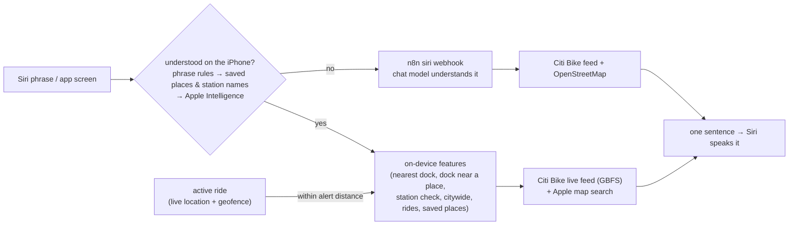

# Citi Bike Smart Dock Assistant

A hands-free helper for Citi Bike riders in NYC. Tell Siri where you're riding, and as you get close it tells you **through your headphones** which nearby dock actually has space, so you never have to pull out your phone while riding.

> "Hey Siri, start a ride with Dock Finder."
> Siri: "Where are you heading?"
> "School."
> Siri: "Got it. I'll tell you where to dock when you're about 0.3 miles from school."
> *…as you get close:* "Your usual dock is full. Go to Washington and Greene, 8 docks, 350 feet from school."

Built as a group capstone project. The main product is **Dock Finder**, a native iPhone app (SwiftUI, Siri, App Intents) that reads Citi Bike's public live feed directly. An [n8n](https://n8n.io) workflow answers the free-form questions the phone can't understand, and powers an older Shortcuts-only version for riders without the app.

## The problem

Riding to class, we kept arriving to find the nearby docks already full. Then you have to stop, unlock your phone, open the Citi Bike app and hunt for another station, which is annoying and unsafe on a bike. We wanted something that checks live availability, remembers the docks you normally use, and reroutes you before you get there, entirely by voice.

## What to say to Siri

These work with the phone locked once Dock Finder is installed. Nothing needs to be turned on first.

### The two you need

| Say | Siri asks | Then |
|---|---|---|
| **"Hey Siri, start a ride with Dock Finder"** | "Where are you heading?" | Answer with a saved place ("school"), a landmark ("Union Square", "NYU Stern") or an address ("44 West 4th Street"). Siri then asks "Want me to guide you to the dock when you're close?" Ride; as you get close, you hear where to dock, and with "yes", each turn on the way there. |
| **"Hey Siri, find a dock with Dock Finder"** | "Want me to direct you there?" | The nearest station to you with room, right now. Say "yes" to hear each turn on the way. |

### Directions to the dock

Whenever Siri tells you about a dock (Find Dock, Check Station, your saved place's dock, Ask Dock Finder), it ends with **"Want me to direct you there?"** Say **"yes"** and Dock Finder guides you there turn by turn through your headphones, with the phone locked:

> "0.3 miles to West 4th and Mercer. Head north on 6th Avenue." … "In 500 feet, turn right onto Bleecker Street." … "Turn right onto Bleecker Street." … "You've arrived at West 4th and Mercer, 8 docks open."

- If you leave the route, it says "Rerouting" and gives the new next turn.
- It re-checks the dock every couple of minutes and once more as you get close. If the dock fills up: "West 4th and Mercer is full now. Heading to Mercer and Bleecker instead, 6 docks open."
- The next turn, the distance to it and the dock's open docks also show on the **Lock Screen and in the Dynamic Island**.
- **"Hey Siri, stop directions with Dock Finder"** (or "end my ride…") stops it. It also stops on its own at the dock, or after 45 minutes.
- Said "no" by mistake? **"Hey Siri, direct me with Dock Finder"** guides you to the dock you were just told about (or the nearest one with room).
- On a ride, say "yes" to "Want me to guide you to the dock when you're close?" and the arrival alert turns straight into directions.

### All phrases

| Phrase (say "Hey Siri, …") | What it does |
|---|---|
| **Start a ride with Dock Finder**<br>also: *Begin a ride with…*, *Start riding with…*, *New ride with Dock Finder* | Asks where you're heading, then alerts you near the destination with the best dock |
| **End my ride with Dock Finder**<br>also: *Cancel my ride with Dock Finder* | Stops watching the current ride, and any directions |
| **Find a dock with Dock Finder**<br>also: *Find me a dock with…*, *Find a dock in…*, *Find an available dock with…*, *Find an open dock with…*, *Find the nearest dock with…*, *Find a dock near me with Dock Finder*, *Nearest dock in Dock Finder* | Nearest dock with room to where you are |
| **Check my *school* dock with Dock Finder** (any saved place's name) | Your usual dock there; if it's full, your backup, then the nearest other station with room |
| **Check a station with Dock Finder**<br>also: *Is a station full in Dock Finder* | Asks "Which station?", then says how many docks and bikes it has, and where to go if it's full |
| **Citi Bike status in Dock Finder**<br>also: *Check Citi Bike citywide with Dock Finder* | Citywide bikes, open docks and full stations |
| **Ask Dock Finder**<br>also: *Talk to Dock Finder* | Asks "What do you need?", then takes anything in your own words (below) |
| **Direct me with Dock Finder**<br>also: *Guide me to a dock with…*, *Get directions with Dock Finder* | Turn-by-turn directions to the dock you were just told about, or the nearest dock with room |
| **Stop directions with Dock Finder**<br>also: *Cancel directions with…*, *Stop guiding with Dock Finder* | Stops turn-by-turn directions (during a ride, before you arrive, it turns off guidance for that ride) |

### What you can say to "Ask Dock Finder"

| You want | Say, for example |
|---|---|
| A dock near you | "near me", "here", "nearest", "where can I park?" |
| A dock near a place | "find a dock near Union Square", "close to NYU Stern", or just "school" |
| Whether a station has room | "is Mercer and Bleecker full?", "does Court and State have room?", "check Lafayette and 8th", "how many docks at Mercer and Bleecker?", or just the station name |
| Your usual dock | "is my school dock full?", "check my school dock" |
| Citywide totals | "how many bikes are out?", "citywide", "system status" |
| Start a ride | "start a ride to school", "I'm heading to Union Square", "take me to 44 West 4th Street" |
| End a ride | "end my ride", "cancel trip", "I'm done riding" |
| Directions to the dock just mentioned | "take me there", "direct me", "guide me to the dock", "directions" |
| Stop directions | "stop directions", "cancel directions", "stop guiding" |
| Set a usual dock | "my school dock is Mercer and Bleecker", "set my work dock to Court and State" |
| Save where you're standing | "save this spot as gym", "remember here as office" |

Anything else goes to the n8n server, if the app was built with one. Without a server, you get a short help message.

### Tips

- **Don't say "run Dock Finder" or "open Dock Finder"** if the app is installed. Siri treats a launch verb plus the app's name as "open the app", which needs the phone unlocked. (Riders using only the Shortcuts version, without the app, do say "run Dock Finder"; see [docs/onboarding.md](docs/onboarding.md).)
- **"Home", "work", "my gym"** only work as destinations once you've saved them in the app. Dock Finder won't guess a business called "Home" on the map.
- **Nicknames:** give a saved place other names ("Stern", "class") in the app, and Siri recognizes them too.
- **"Doc" vs "dock":** dictation often hears "dock" as "doc"; the app handles both, and "Doc Finder" works as the app name.
- **Ride alerts and directions with the phone locked** need **Always** location access (Settings → Dock Finder → Location). With only *While Using*, Siri's answer tells you so.
- **The app's voice:** Siri's replies use your Siri voice, but iOS doesn't let apps borrow it for their own speech (ride alerts and turn-by-turn directions). Dock Finder picks the closest male voice on the phone and speaks a little slower than normal. For a better-sounding voice, download an "Enhanced" or "Premium" male English voice in Settings → Accessibility → Spoken Content → Voices.
- **Only if you built your own automation** (most riders haven't): an *automation* is something you set up in Apple's Shortcuts app to run by itself, e.g. "when I arrive near school, run Dock Finder's *Find Dock Near Saved Place* and read the answer out loud" (that's an **Arrive** automation; see the [iOS README](ios/README.md#arrival-alerts-with-a-shortcuts-automation-older-approach)). Nobody is talking to Siri when an automation runs, so nobody can answer "Want me to direct you there?" In that automation, tap the Dock Finder action and switch **Offer Directions** off. Talking to Siri yourself is unaffected.
- **If Siri runs the wrong action** after installing a new build, delete the app and install it again; iOS caches which phrase runs which action.
- **A shorter phrase:** in the Shortcuts app, make a shortcut with Dock Finder's **Start Ride** action and name it something like **Ride Check** (not "Dock Finder"). Then "Hey Siri, ride check" works the same way.

## Using the app

The first time it opens, tap **Enable Dock Finder with Siri** to allow location, then read the Siri cheat sheet. After that, the home screen has:

- **Find Nearest Dock**: the answer, with a **Direct Me** button for spoken turn-by-turn directions. Every dock answer in the app has **Direct Me**.
- **Directions card**: while directions run, the next turn, the dock and its open docks, and **Stop Directions**.
- **Ride card**: **Start a Ride** (pick a saved place or search an address, and choose whether to be guided to the dock). During a ride it shows the distance left, a **Guide me to the dock** switch and an **End Ride** button, and afterwards what was said on arrival.
- **Saved Places**: **Add a Place** by searching an address or using your current location, then name it (that's what you say to Siri), add nicknames, and pick how far out a ride alerts you (0.2 to 0.7 miles). Open a place to pick its **Usual Dock** and **Backup Dock**, see its live status, start a ride there, edit or delete it.
- **More**: Dock Near a Place, Check a Station, Citywide Status, and Ask Dock Finder (type a question, or tap an example).
- **How to Use with Siri**: the phrase cheat sheet again.

**Recommended setup:** add School, Work and Home with a usual and backup dock for each, allow Always location, and from then on just say "Hey Siri, start a ride with Dock Finder" → "school".

### What it says (examples)

| Situation | Spoken answer |
|---|---|
| Ride started | "Got it. I'll tell you where to dock when you're about 0.3 miles from school." |
| Usual dock OK | "Your usual dock has 25 docks open." |
| Usual dock full | "Your usual dock is full. Go to Washington and Greene, 8 docks, 350 feet from school." |
| Near me | "West 15th and 6th has 53 docks open, right there." |
| Station check | "Mercer and Bleecker has 29 docks open and 4 bikes." |
| Near a place | "East 17th and Broadway has 47 docks open, 500 feet from union square." |
| Whole system | "35,393 bikes and 30,882 open docks citywide. 243 stations are full." |

Station names are rewritten the way New Yorkers say them ("W 15 St & 6 Ave" becomes "West 15th and 6th"), so Siri doesn't read "St" as "Saint". A station counts only if it's accepting returns, has **at least 2** open docks and reported in the last hour. Distances are straight-line.

## How it works



- **On the iPhone first.** Every feature runs on the phone, reading Citi Bike's public [GBFS feed](https://gbfs.citibikenyc.com/gbfs/en/) (no API key) and Apple's map search. Saved places are stored only on the phone.
- **Rides** track location in the background the way navigation apps do, plus a geofence around the destination that relaunches the app if iOS closed it. At the alert distance it speaks the answer (ducking music) and posts it as a notification, then the ride ends. Rides stop after 60 minutes if you never arrive.
- **The n8n server is a fallback** for free-form questions the phone can't understand, or places and stations it can't find. A chat model classifies the request into a fixed JSON schema; **it never writes the answer**. Plain JavaScript does, so every number comes from the live feed. OpenStreetMap Nominatim looks up places, and the model rewrites nicknames ("that bagel place by Stern") into addresses when the lookup fails.
- **Shortcuts-only version.** Before the app, riders used shared iPhone shortcuts ("Hey Siri, run Dock Finder", the Action Button, and an Arrive automation per place) that call the n8n webhooks. They still work; see [docs/onboarding.md](docs/onboarding.md) and [docs/shortcuts.md](docs/shortcuts.md).

## Repo layout

```
ios/
  biker-app.xcodeproj                            # the Dock Finder app; see ios/README.md
  biker-app/                                     # app source
  DockFinderTests/                               # unit tests
n8n/
  citibike-smart-dock-assistant.workflow.json   # import this into n8n
  code-nodes/                                    # readable copies of the workflow's JavaScript nodes
shortcuts/
  build_shortcuts.py                             # builds the signed, shareable .shortcut files (output in shortcuts/dist/, gitignored)
  generate_docs.py                               # regenerates docs/shortcuts.md (CI runs it on every push)
docs/
  onboarding.md                                  # new-rider guide (app and Shortcuts-only paths)
  shortcuts.md                                   # how every shared shortcut works, step by step (auto-updated on each push)
  iphone-setup-handoff.md                        # Shortcuts-only iPhone setup, written for an AI assistant to walk a rider through
  project-summary.pdf                            # one-page-per-topic project overview
```

The workflow JSON is the source of truth for the server; `code-nodes/` holds copies of its Code nodes so the logic is easy to read and review on GitHub.

## Set it up

### 1. The app

There's no TestFlight build yet, so each tester installs it from Xcode on a Mac (a free Apple ID is enough; iPhone on iOS 26.5 or newer). Follow [Testing the developer preview on your own iPhone](ios/README.md#testing-the-developer-preview-on-your-own-iphone). The app works fully without the server; set `DOCKFINDER_BACKEND_HOST` only if you want free-form questions answered by n8n.

### 2. Backend (n8n, optional for the app)

1. In n8n (Cloud or self-hosted), create a workflow, then **⋯ → Import from File** and pick `n8n/citibike-smart-dock-assistant.workflow.json`.
2. Open the chat model nodes (attached to **understand request** and **ai address**) and pick your model and credential (OpenAI, Anthropic, etc.). If a model offers a reasoning-effort setting, use the lowest.
3. **Save** and **Publish**.
4. Copy the **Production URL** from the **siri webhook** and **arrival webhook** nodes (use `/webhook/`, not `/webhook-test/`).

Quick test from a terminal:

```bash
curl -X POST "https://YOUR-N8N-HOST/webhook/citibike-arrival" -H "Content-Type: application/json" -d '{"lat":40.738,"lon":-73.996}'
```

### 3. Shortcuts-only riders (no app)

See [docs/onboarding.md](docs/onboarding.md). Riders add a few shortcut files a teammate sends them, answer two questions, and make one automation per place. Whoever shares the files builds them with `shortcuts/build_shortcuts.py --host YOUR-N8N-HOST`. For a guided setup, give [`docs/iphone-setup-handoff.md`](docs/iphone-setup-handoff.md) (with your n8n address filled in) to ChatGPT or Claude and say "help me set this up on my iPhone".

**Webhook URLs have no authentication.** Anyone with them can query the assistant and spend your AI credits. Share them, and app builds that contain them, only with people you trust.

## Decisions we made

- **A native app for rides.** Google Maps doesn't expose your navigation destination to other apps, so the first version could only alert you near pre-set places via "Arrive" automations. The app lets you start a ride to *any* destination by voice and alerts you there.
- **Siri instead of a Telegram bot.** Our first voice prototype used Telegram, but voice notes need the phone unlocked and a button held, and replies don't auto-play. Siri is truly hands-free, and the phone does speech recognition and text-to-speech for free.
- **One question, then the answer.** "Start a ride with Dock Finder" asks only "Where are you heading?"; the destination reaches the app as plain text, so Siri can't turn it into a Maps search (or a search for doctors).
- **Spoken-first answers.** Anything spoken is one sentence: where to go, how many docks, how far.
- **AI only where it helps.** Fixed requests are plain code on the phone; only free-form questions go through a model, on device first.

## Costs

| Piece | Cost |
|---|---|
| Citi Bike feed, Apple map search, OpenStreetMap lookups, iPhone speech, on-device AI | Free |
| Server chat model per free-form question the phone can't answer | ≈ $0.002 or less |
| n8n hosting | n8n Cloud plan, or free/self-hosted |

## Limitations and next steps

- **Not yet verified end to end on a physical iPhone**: locked-phone rides, geofence relaunch, background speech, Siri's yes/no follow-ups, turn-by-turn directions and the Live Activity. See the [manual checklist](ios/README.md#manual-verification-checklist-physical-iphone).
- Turn-by-turn directions use Apple's cycling routes and straight-line GPS matching; in Manhattan's tall-building canyons, GPS can be 10–20 m off, so a turn can be announced a little early or late.
- Distances are straight-line, not riding distance.
- The closest dock with ≥2 spaces wins, even if a much roomier one is only slightly farther. Next: prefer stations with a bigger buffer when they're nearly as close.
- Server conversation memory is in n8n's in-memory store and resets on restart.
- No TestFlight build yet; free-team installs expire after 7 days.

## Credits

Data: Citi Bike / Lyft [GBFS](https://github.com/MobilityData/gbfs) feed, © [OpenStreetMap](https://www.openstreetmap.org/copyright) contributors. This is a student project and is not affiliated with Citi Bike, Lyft, or Apple.
